<!-- Generated by scripts/build-readme.mjs from profile.config.json. Edit the config, not this file. -->

<a href="https://github.com/kietly-web"></a>

<p align="center"></p>

<p align="center">
  <a href="https://github.com/kietly-web"></a>
  <a href="https://seller-business-advisor.vercel.app"></a>
  
</p>

## 👨‍💻 About me

```ts
const kiet = {
  building:   "Shopee Seller Advisor, AI decisions for small Vietnamese sellers", // 🔭
  exploring:  "How far AI coding agents can go on a production-grade system",     // 🤖
  learning:   "Postgres RLS, LLM guardrails, privacy-first data pipelines",       // 🌱
  askMeAbout: "AI product discovery, Next.js, TypeScript",                        // 💬
} as const;
```

## 🛠️ Tech stack

<p align="center">
  <picture><source media="(prefers-color-scheme: dark)" srcset="https://skillicons.dev/icons?i=ts%2Cjs%2Cnodejs%2Cnextjs%2Creact%2Cpostgres%2Cvercel%2Cgithubactions%2Cpnpm%2Cgit&perline=10&theme=dark"></picture>
</p>

## 🚀 Featured work

<a href="https://github.com/kietly-web/seller-business-advisor"><picture><source media="(prefers-color-scheme: dark)" srcset="https://raw.githubusercontent.com/kietly-web/kietly-web/output/project-seller-business-advisor-dark.svg"></picture></a>

- **Rules first, LLM explains.** The engine computes every number; the model writes text with `{{placeholders}}`, and any stray digit in its output is rejected.
- **Privacy by construction.** Seller Centre exports are parsed in the browser and buyer PII columns are dropped before anything is uploaded.
- **Tenant isolation in Postgres.** Row-level security on every shop table, with a generated test suite that fails if a new table skips it.
- **Built like it'll have real users.** 9 ADRs, Better Auth with 2FA and breached-password checks, a Postgres job queue, and compliance docs for Vietnam's AI law.

<sub>[Source](https://github.com/kietly-web/seller-business-advisor) · [**Live demo →**](https://seller-business-advisor.vercel.app)</sub>

<p align="center">
  <a href="https://github.com/kietly-web/ai-learning"><picture><source media="(prefers-color-scheme: dark)" srcset="https://raw.githubusercontent.com/kietly-web/kietly-web/output/project-ai-learning-dark.svg"></picture></a>
</p>

## 📊 By the numbers

<p align="center">
  <picture><source media="(prefers-color-scheme: dark)" srcset="https://raw.githubusercontent.com/kietly-web/kietly-web/output/stats-dark.svg"></picture>
  <picture><source media="(prefers-color-scheme: dark)" srcset="https://raw.githubusercontent.com/kietly-web/kietly-web/output/languages-dark.svg"></picture>
</p>

<p align="center">
  <picture><source media="(prefers-color-scheme: dark)" srcset="https://raw.githubusercontent.com/kietly-web/kietly-web/output/activity-dark.svg"></picture>
</p>

## ⚡ Recently shipped

- 🟣 <a href="https://github.com/kietly-web/seller-business-advisor/pull/21"><code>SA-000</code> adopt lean mode and add production migrations</a> <sub>· seller-business-advisor · 05 Nov 2026</sub>
- 🟣 <a href="https://github.com/kietly-web/seller-business-advisor/pull/20"><code>SA-105</code> add Better Auth email sign-up with verification, 2FA and HIBP</a> <sub>· seller-business-advisor · 05 Nov 2026</sub>
- 🟣 <a href="https://github.com/kietly-web/seller-business-advisor/pull/19"><code>SA-002</code> delete Neon preview branches when a PR closes</a> <sub>· seller-business-advisor · 05 Nov 2026</sub>
- 🟣 <a href="https://github.com/kietly-web/seller-business-advisor/pull/18"><code>SA-110</code> add data inventory, AI classification memo and breach runbook</a> <sub>· seller-business-advisor · 04 Nov 2026</sub>
- 🟣 <a href="https://github.com/kietly-web/seller-business-advisor/pull/17"><code>SA-108</code> add audit action catalogue</a> <sub>· seller-business-advisor · 04 Nov 2026</sub>

<p align="center">
  <picture><source media="(prefers-color-scheme: dark)" srcset="https://raw.githubusercontent.com/kietly-web/kietly-web/output/snake-dark.svg"></picture>
</p>

<p align="center"><i>“Every number is computed, never generated.”</i></p>

<div align="center">

<sub>✨ Like this profile? The template is free for anyone to use: <a href="https://github.com/kietly-web/kietly-web/blob/main/SETUP.md">grab it here</a> and let Claude make it yours.</sub>

</div>


